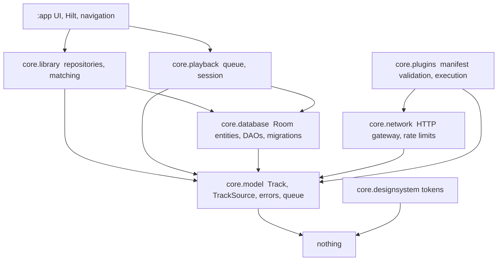

# Dependency graph and the enforced direction

**Task:** TUN-0107. `SPEC/ARCHITECTURE.md` fixes the direction ("UI -> domain interfaces/use cases
-> repositories -> providers/database/network") and the plugin restrictions ("plugins must not see
Room, Android Context, host tokens, MediaStore or raw HTTP clients"). This file is the readable
version of those rules; `SCRIPTS/check_boundaries.py` is the version a build can fail on. **B9**
(see below) fails if a rule here and a rule there drift apart.

## Modules

```
:app   -> :core            (the app depends on core; core never depends on the app)
:core  -> third-party libraries only
```

`:core` holds packages, not a dozen Gradle modules (`SPEC/ARCHITECTURE.md`: "avoid dozens of empty
modules"). A package becomes a module only when there is a reason — build time, a real API
boundary, or a dependency that must not leak.

## Packages inside `:core`, and what each may see



The picture is deliberately acyclic: nothing points back down towards the UI, and the domain sits
underneath everything.

## Rules

| Rule | Statement |
|---|---|
| **B1** | `com.tunenagi.core.model` imports no Android, Compose, Room, network or storage type. The domain must stay plain Kotlin so it is testable on the JVM (ADR-008 depends on this). |
| **B2** | `com.tunenagi.core.database` may use `model` and nothing above it: no `library`, `playback`, `plugins` or `network`. |
| **B3** | `com.tunenagi.core.playback` may use `model` and `database`; it may not reach into `library` or `plugins`. |
| **B4** | `com.tunenagi.core.library` may use `model` and `database`; it may not reach into `playback` or `plugins`. |
| **B5** | `com.tunenagi.core.plugins` may not import Android, Room, raw HTTP clients, `database` or `library`. A plugin gets data through the host network gateway. |
| **B6** | `:core` must not depend on the `:app` module, in code or in a build script. |
| **B7** | `:app` may not import `com.tunenagi.core.database`: the UI talks to domain interfaces, so no screen can bypass a repository. |
| **B8** | No data or domain package may import Compose UI, and `core.designsystem` must not reach into storage, library or playback. Design tokens are values, not behaviour. |
| **B9** | Every rule above is named in this document (the check reads this table). |

## What the check reads

- Tracked Kotlin files, read from **git's stored content** with `git show :<path>` (the same
  technique as `check_format.py`), so a CRLF checkout cannot change the verdict.
- Files under `src/main`, `src/test`, `src/sharedTest` and `src/androidTest`. Test sources are in
  scope on purpose: a test that reaches around a boundary is the first sign the production code
  will.
- `core/*.gradle.kts` for B6 and `app/src/main/java/**` for B7.

Run it directly with `python SCRIPTS/check_boundaries.py`, list the rules with `--list`, or prove it
can fail with `--self-test` (it does: the self-test feeds it a domain file importing Android, a data
file importing a higher layer, a plugin importing Room and Context, playback importing the library
layer, a UI file importing the database, and `:core` declaring a dependency on `:app`). It is step
`boundaries` of `SCRIPTS/verify.py`, and therefore also a step of CI.

## Changing a rule

A rule is a contract, so relaxing one is a decision, not a detail: record it in
`STATE/decisions.md` with the reason, and change this table and `SCRIPTS/check_boundaries.py` in the
same commit. Loosening a rule to make an existing file pass is exactly what B9 exists to make
visible. As with the other gate scripts, a change to the enforcement code needs independent audit
coverage at the phase gate (`OPERATIONS/STATE_PROTOCOL.md`, "self-change restrictions").
